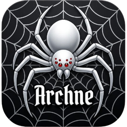
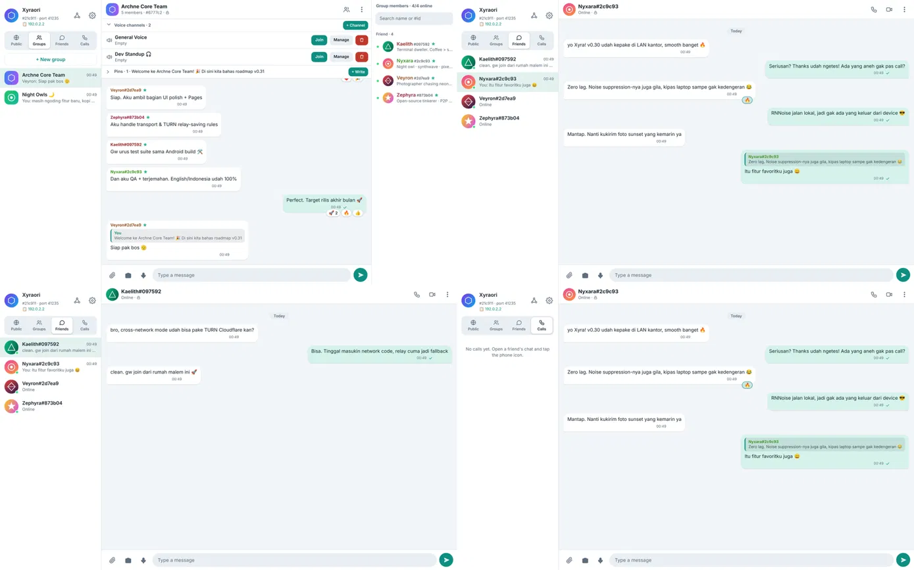
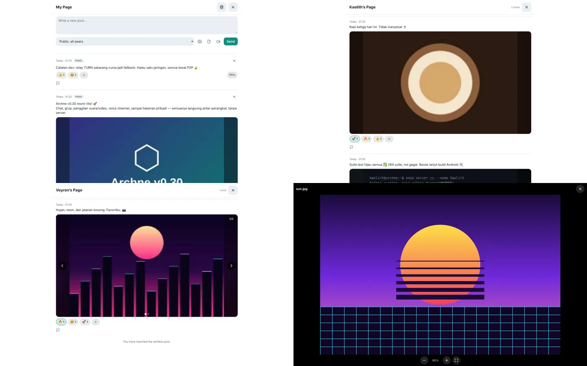
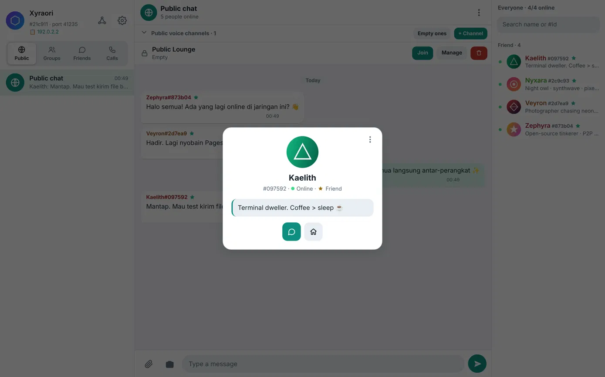
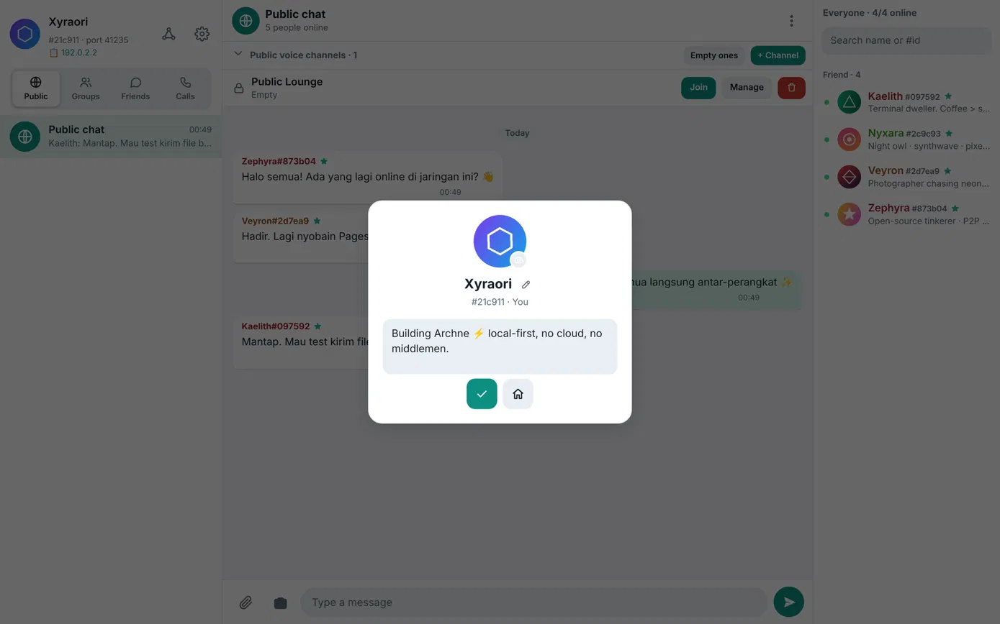

<div align="center">



# Archne

### Sosial media lokal, tanpa awan.

**Tanpa server. Tanpa akun. Tanpa perantara.**
Ngobrol, telepon, dan berbagi berkas langsung antar perangkat.
Identitasmu cuma sepasang kunci di perangkatmu sendiri.


[English](README.md) · **Bahasa Indonesia**

[Fitur](#-fitur) · [Instalasi](#-instalasi) · [Build](#-build) · [Cara kerja](#-cara-kerja) · [Pengembangan](#-pengembangan) · [Changelog](CHANGELOG.id.md)

</div>

 
 

---

## Kenapa Archne?

Kebanyakan aplikasi chat bergantung pada server milik perusahaan: akunmu ada di sana, pesanmu lewat sana, dan kalau server mati, aplikasinya ikut mati.

Archne dibuat dengan arah sebaliknya. Setiap perangkat adalah **peer** yang setara. Perangkat saling menemukan di jaringan yang sama (Wi-Fi atau LAN), lalu bertukar pesan, panggilan, dan berkas **langsung**. Tidak ada server pusat yang harus dipercaya, dibayar, atau bisa hilang. Untuk teman di jaringan lain, tersedia **mode lintas jaringan** dengan kode jaringan pribadi.

> **Status: beta.** Fitur utama sudah berjalan dan dipakai sehari-hari, tetapi masih ada bagian yang bisa berubah. Menemukan bug? Silakan buka *issue*.

### 🆕 Baru di 0.31.0
- **Android dibangun ulang dengan Capacitor 8** dan runtime **Node 24**. Cordova sudah tidak dipakai.
- **Dukungan page size 16 KB** untuk perangkat Android yang lebih baru (diperiksa dengan `zipalign`).
- **Desktop pindah ke Electron 45** (electron-builder 26).
- Android: notifikasi panggilan lebih baik (Jawab / Tolak, tampil di layar kunci), tampilan edge-to-edge, penanganan tombol Kembali, serta ekspor/impor Halaman.

> **Memperbarui dari 0.30.0?** Ini perubahan internal yang besar. Data aplikasi lama **tidak** dibawa. Android hanya mau memasang APK baru di atas yang lama bila keduanya ditandatangani kunci yang sama; kalau tidak, uninstall dulu. Rincian lengkap ada di [changelog](CHANGELOG.id.md).

---

## ✨ Fitur

### 💬 Obrolan
- **Chat pribadi, grup, dan ruang publik** di jaringan lokal.
- **Pesan tetap sampai walau tujuan sedang offline.** Peer lain ikut menitipkan pesan terenkripsi dan mengantarkannya begitu penerima online lagi, lengkap dengan tanda terima.
- **Balas, reaksi emoji, hapus, dan sematkan pesan** lewat menu aksi di tiap pesan.
- **Manajemen grup**: pemilik dan admin, undang atau keluarkan anggota, avatar grup.
- **Pertemanan, blokir, dan perlindungan spam** bawaan.
- **Tautan web** terbuka di peramban mini di dalam aplikasi.

### 📞 Panggilan
- **Panggilan suara dan video** satu lawan satu.
- **Panggilan grup** sampai 8 peserta.
- **Channel suara** untuk grup (bisa dikunci per anggota) dan **channel suara publik** dengan PIN 6 angka.
- **Peredam kebisingan** berbasis RNNoise, jalan lokal di perangkatmu.
- Riwayat panggilan dan penanda panggilan tak terjawab.

### 📎 Berkas dan media
- **Kirim berkas** langsung antar perangkat, dikompres tanpa kehilangan data dan dienkripsi sebelum dikirim.
- **Kirim Langsung (Direct Exchange)** untuk bertukar berkas dengan pelacakan progres.
- **Foto dan video dari kamera**, **pesan suara**, penampil gambar (zoom, geser), dan pemutar media bawaan.

### 📰 Halaman
Halaman adalah ruang postinganmu sendiri, mirip profil sosial media tetapi tersimpan di perangkatmu.
- Posting teks, gambar, video, dan lampiran.
- **Komentar bertingkat**, balasan, dan **reaksi** pada komentar.
- Hapus komentarmu sendiri di halaman orang lain.
- Komentar dan reaksi baru muncul **langsung** tanpa muat ulang.
- **Cadangan dan pemulihan** seluruh halaman ke satu berkas `.archpg`.
- Pengaturan privasi per postingan (hanya teman, larang unduh).

### 🌐 Lintas jaringan
- Hubungkan perangkat yang berbeda jaringan dengan **kode jaringan** dan tautan undangan `archne://join?...`.
- Signaling terenkripsi, koneksi WebRTC langsung, dan dukungan **TURN** (Cloudflare, Metered, atau manual) sebagai cadangan.
- Aturan hemat kuota relay supaya berkas besar tidak menghabiskan kuota TURN.

### 🎨 Tampilan dan kenyamanan
- Tema **terang dan gelap**.
- Dua bahasa: **English** dan **Bahasa Indonesia**.
- Notifikasi di desktop dan Android, termasuk aksi cepat dari notifikasi Android.
- Berjalan sebagai **aplikasi desktop**, **APK Android**, atau **langsung di peramban**.

---

## 📦 Instalasi

### Kebutuhan
- **Windows 10 / 11** untuk aplikasi desktop. Skrip `.bat` memasang Node.js LTS lewat `winget` bila belum ada.
- **Node.js 22.12 atau lebih baru** (disarankan LTS) untuk menjalankan dari sumber, mode peramban, dan build.
- **Android 7.0 (API 24) atau lebih baru** untuk menjalankan aplikasi Android.
- **Untuk membangun APK:** JDK 21 dan Android SDK (platform 36, CMake). `mobile.bat` memasang keduanya bila belum ada, jadi Android Studio opsional.
- **Git** (opsional, untuk meng-clone repo).

### Cara termudah (Windows)

```bash
git clone https://github.com/AdyXSetya/archne.git
cd archne
```

1. Jalankan **`setup.bat`**. Node.js dan dependensi dipasang otomatis.
2. Jalankan **`run.bat`** untuk membuka Archne.
3. *(Opsional)* Jalankan **`firewall.bat`** bila perangkat lain tidak bisa menemukanmu di jaringan. Skrip ini meminta hak administrator.

### Lewat terminal (semua sistem operasi)

```bash
npm install
npm start          # buka aplikasi desktop (Electron)
```

### Mode peramban / headless (Linux, macOS, Termux)

Tanpa Electron. Cocok untuk Termux di HP atau uji cepat.

```bash
npm install
npm run serve
# atau dengan opsi:
node server.js --name "Namaku" --port 8080 --data ./data-archne
```

Buka tautan yang dicetak di terminal. Tautan itu berisi token sesi yang hanya berlaku di perangkat tersebut.

| Opsi | Fungsi |
|---|---|
| `--name` | Nama tampilan (bawaan: nama pengguna sistem) |
| `--port` | Port UI (bawaan: dipilih otomatis) |
| `--data` | Folder data (bawaan: `~/.archne`) |

### Port yang dipakai

| Port | Protokol | Fungsi |
|---|---|---|
| `41234` | UDP | Penemuan peer di jaringan lokal |
| `41235` | TCP | Komunikasi antar peer (bawaan) |

Izinkan keduanya di firewall bila perangkat saling tidak terlihat.

---

## 🔨 Build

Hasil build ada di folder `dist/`.

### Windows (installer dan portable)

```bash
build.bat            # atau: npm run dist
```

Menghasilkan installer **NSIS** dan versi **portable** `.exe`. Build pertama mengunduh komponen Electron, jadi butuh waktu.

> Sejak Electron 42, `npm install` tidak lagi mengunduh binary Electron. `setup.bat` mengunduhnya untukmu, atau otomatis saat `npm start` pertama.

### Android (APK)

Satu perintah mengerjakan semuanya. Saat pertama kali dijalankan, **JDK 21** dan **Android SDK** (platform 36, CMake) dipasang otomatis bila belum ada:

```bash
mobile.bat                    # APK debug (semua ABI)
mobile.bat -Install           # ...lalu pasang ke HP yang terhubung lewat adb
mobile.bat -Release           # APK rilis bertanda tangan
mobile.bat -Release -Aab      # ...plus AAB untuk Google Play
mobile.bat -Abis arm64-v8a    # satu ABI saja (APK lebih kecil)
```

Aplikasi Android adalah cangkang **Capacitor 8** murni dengan runtime **Node 24** dari `@capawesome/capacitor-nodejs`, jadi inti Archne yang sama berjalan langsung di HP. Tidak ada Cordova. Runtime Node (`libnode.so`) sekitar 120 MB per arsitektur CPU, karena itu APK universal memuat semua arsitektur yang didukung (`arm64-v8a`, `armeabi-v7a`, `x86_64`). AAB Play hanya mengirim yang cocok per perangkat.

#### Tanda tangan rilis (wajib dicadangkan)

`-Release` menandatangani APK dengan `%USERPROFILE%\.archne\archne-release.jks` (alias `archne`, password di `release.pass` di sebelahnya). Bila kunci belum ada, kunci dibuat saat build rilis pertama.

**Salin folder itu ke tempat pribadi**, misalnya flashdisk. Jangan di-commit ke Git atau dibagikan lewat chat (`.gitignore` sudah memblokir `*.jks`). Android hanya mengizinkan APK baru menimpa aplikasi terpasang bila keduanya ditandatangani kunci yang sama. Bila kunci hilang, semua pengguna harus uninstall dulu dan kehilangan data lokalnya.

### Windows dan Android sekaligus

```bash
build-all.bat
```

### Daftar skrip

| Skrip | Fungsi |
|---|---|
| `setup.bat` | Pasang Node.js dan dependensi |
| `run.bat` | Jalankan aplikasi desktop |
| `debug.bat` | Jalankan dengan log diagnostik |
| `serve.bat` | Jalankan mode peramban |
| `firewall.bat` | Buka aturan firewall Archne (admin) |
| `build.bat` | Bangun installer Windows |
| `mobile.bat` | Bangun APK Android (`-Install`, `-Release`, `-Aab`, `-Abis`) |
| `build-all.bat` | Bangun Windows dan Android |

Log skrip tersimpan di folder `logs/`.

---

## 🧭 Cara kerja

**Tanpa server.** Tiap perangkat menjalankan inti Archne sendiri. Peer ditemukan lewat siaran UDP di jaringan lokal, lalu bicara langsung lewat TCP.

**Identitas berbasis kunci.** Tidak ada email, nomor telepon, atau kata sandi. ID-mu diturunkan dari kunci publik yang dibuat di perangkatmu, dan pesan ditandatangani dengan kunci pribadimu.

**Terenkripsi.** Berkas dienkripsi dengan AES-256-GCM sebelum dikirim, dan sinyal lintas jaringan dibungkus enkripsi yang kuncinya diturunkan dari kode jaringan.

**Titip pesan (store and forward).** Bila penerima offline, pesan terenkripsi dititipkan ke peer lain dengan kuota dan masa berlaku, lalu dikirim ulang saat penerima kembali. Pengirim mendapat tanda terima ketika pesan sampai.

**Data tetap di perangkatmu.** Pesan, halaman, dan berkas disimpan lokal. Tidak ada cloud.

> Archne masih beta dan belum diaudit keamanannya secara independen. Jangan jadikan satu-satunya sarana untuk komunikasi berisiko tinggi.

---

## 🩹 Pemecahan masalah

| Masalah | Coba ini |
|---|---|
| Perangkat lain tidak bisa melihatku | Jalankan `firewall.bat` (Windows) atau izinkan UDP `41234` dan TCP `41235`. Pastikan kedua perangkat di Wi-Fi/LAN yang sama dan router tidak mengisolasi klien (AP isolation). |
| Tautan mode peramban tidak terbuka | Pakai tautan lengkap yang dicetak di terminal, termasuk tokennya. Buka di perangkat yang sama dengan yang menjalankan `npm run serve`. |
| Teman beda jaringan | Pakai mode lintas jaringan: bagikan kode jaringan atau tautan undangan `archne://join?...`. |
| Panggilan gagal antar jaringan | Atur penyedia TURN (Cloudflare, Metered, atau manual) di Pengaturan. |
| Ada yang aneh | Jalankan `debug.bat`, cek folder `logs/`, lalu buka *issue* beserta detailnya. |
| Aplikasi Android bermasalah | Sambungkan HP dan jalankan `adb logcat -s NodejsPlugin chromium Capacitor` untuk melihat log Node dan WebView. |
| APK baru tidak bisa menimpa yang lama | Kunci tanda tangannya berbeda. Uninstall aplikasi lama dulu (data lokal hilang). |

---

## 🛠 Pengembangan

```bash
npm install
npm start           # jalankan aplikasi
npm run serve       # mode peramban
npm test            # jalankan seluruh suite tes
```

> `npm test` menjalankan ratusan tes dan bisa memakan waktu beberapa menit. Untuk menjalankan sebagian: `node test/run-all.js nama1 nama2`.

### Struktur proyek

```
archne/
├── main.js, preload.js     Proses utama dan jembatan Electron
├── server.js               Mode peramban / headless
├── src/                    Inti: protokol, penyimpanan, IPC, kripto
│   └── core/               Modul inti (chat, panggilan, grup, halaman, ...)
├── renderer/               Antarmuka (HTML, CSS, JS)
│   ├── js/                 Logika UI per fitur
│   ├── css/                Gaya
│   ├── i18n/               Kamus bahasa (en, id)
│   └── vendor/             Pustaka pihak ketiga (MQTT, RNNoise)
├── mobile/                 Cangkang Android (Capacitor 8 + Node 24)
├── scripts/                Skrip setup dan build
├── docs/                   Catatan perencanaan dan baseline tes
├── CHANGELOG.id.md         Riwayat rilis
└── test/                   Suite tes
```

> **Urutan muat skrip.** Skrip UI di `renderer/js/` adalah skrip global biasa yang dimuat sesuai urutan tag `<script>` di `renderer/archne-index.html`. Nama berkas tidak lagi memakai angka urutan, jadi saat menambah berkas baru, taruh tag-nya di posisi yang tepat pada daftar itu. Tes membaca urutan yang sama dari `archne-index.html`.

### Menambah bahasa atau teks

Kunci teks baru harus ditambahkan di `renderer/i18n/archne-en.js` dan `archne-id.js` sekaligus. Latar belakang dan konvensinya ada di [`docs/PLAN-i18n.md`](docs/PLAN-i18n.md).

---

## Cadangan dan pemulihan halaman

Seluruh Halamanmu bisa dicadangkan ke satu berkas `.archpg` dan dipulihkan di perangkat lain. Batas berikut sama dengan kode (dijaga oleh `test/pagearcdoc.js`):

- Satu berkas (gambar, lampiran, atau video) maksimal **2 GiB**.
- Per postingan: maksimal 10 / 10 / 4 (gambar / lampiran / video).
- Satu arsip memuat maksimal **100.000** postingan dan **200.000** entri.
- Manifest arsip maksimal 32 MiB; JSON satu postingan maksimal 8 MiB.
- Komentar per arsip: maksimal 10.000 komentar + 10.000 nisan (penanda komentar terhapus); satu entri komentar maksimal 64 MiB.
- Format berkas: penanda awal `ARCHPGA1` ... `ARCHPGZ1` di akhir, dengan meta `fmt: 1`.

## 🤝 Kontribusi

Masukan, laporan bug, dan pull request sangat diterima. Karena masih beta, buka *issue* dulu untuk perubahan besar supaya arahnya sejalan.

## 📄 Lisensi

Dirilis di bawah [Lisensi MIT](LICENSE). Pakai, ubah, dan bagikan sesukamu, cukup sertakan pemberitahuan hak cipta dan lisensinya.

---

<div align="center">

Dibuat oleh **xyraori**

</div>
