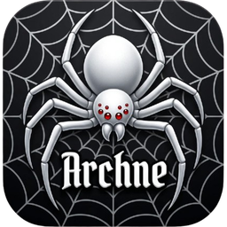
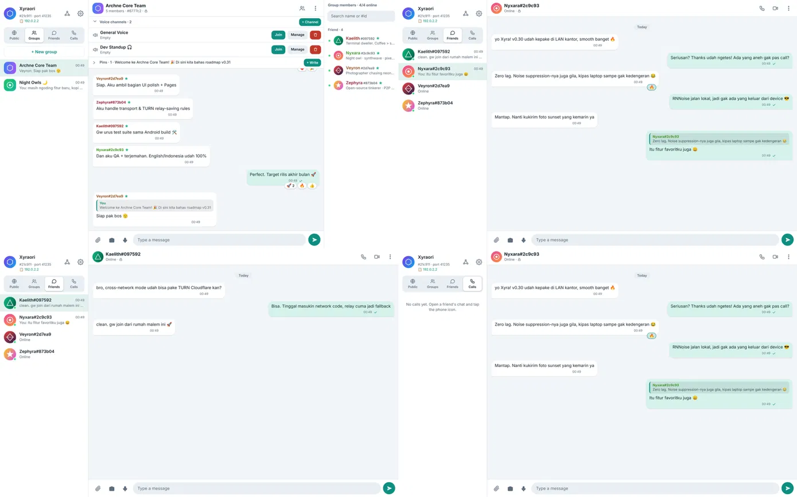
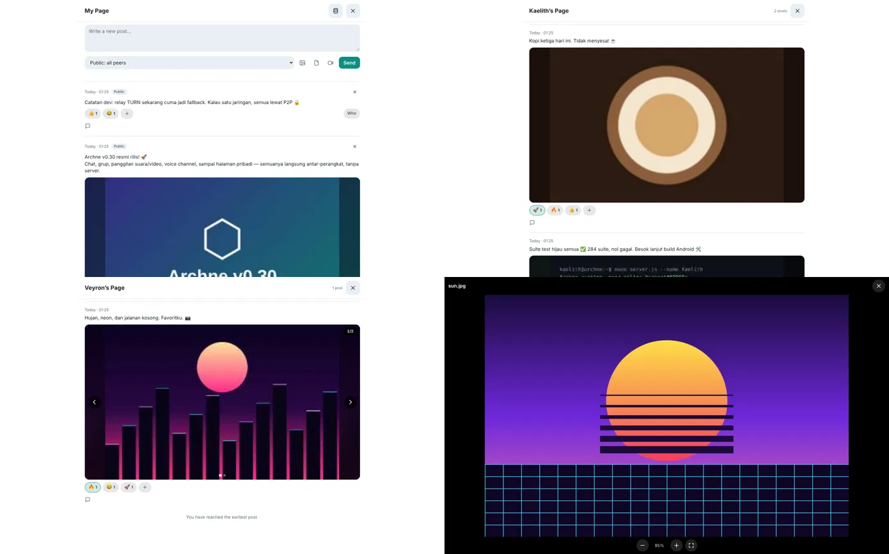

<div align="center">



# Archne

### Serverless peer-to-peer messenger with a built-in personal web host.

**Chat, call, share files, and host websites straight from your device.**
No servers. No accounts. No middlemen.


**English** · [Bahasa Indonesia](README.id.md)

[Features](#-features) · [Install](#-install) · [Build](#-build) · [How it works](#-how-it-works) · [Limitations](#-limitations-and-roadmap) · [Development](#-development) · [Changelog](CHANGELOG.md)

</div>

 
 

---

## Why Archne?

Most chat apps depend on a company's servers. Your account lives there, your messages pass through there, and when the servers go down, so does the app.

Archne takes the opposite approach. Every device is an equal **peer**. Devices find each other on the same network (Wi-Fi or LAN) and exchange messages, calls, and files **directly**. For friends on a different network, **cross-network mode** connects you with a private network code. Your identity is just a key pair that lives on your own device.

On top of that, every device can also be a small **web server**: build a site with HTML, CSS, JS, PHP, and SQLite, and the people connected to you can browse it. No hosting, no domain, no bill.

**Good for**
- Groups on the same Wi-Fi or LAN: events, classrooms, offices, communities, places with weak internet.
- Private chat and file transfer without handing your data to a company.
- Hobbyists who want to host or demo a small PHP site straight from a laptop or phone.

---

## ✨ Features

### 💬 Chat
- **Private chats, groups, and public rooms.**
- **Messages still arrive when the recipient is offline.** Other peers hold encrypted messages for you and deliver them as soon as the recipient is back, with delivery receipts.
- **Reply, react with emoji, delete, and pin** from the action menu on every message.
- **Group management** (owner and admins, invite or remove members, group avatars), friends, blocking, and built-in spam protection.

### 📞 Calls
- **Voice and video calls**, one to one, and **group calls** with up to 8 participants.
- **Voice channels** for groups and **public voice channels** protected by a 6-digit PIN.
- **Noise suppression** (RNNoise) running locally on your device.
- **Screen sharing** (Windows and Android) with optional system sound. It shows everything on your screen, including notifications, so use it only with people you trust.

### 📎 Files and media
- **Send files** directly between devices, compressed and encrypted before they leave your device.
- **Camera photos and videos**, **voice notes**, an image viewer, and a built-in media player.

### 📰 Pages
Your own post space that lives on your device.
- Post text, images, videos, and attachments, with per-post privacy (friends only, disable downloads).
- Threaded comments and reactions that appear instantly.
- **Backup and restore** the whole page, with comments and reactions, as a single `.archpg` file.

### 🌍 Web
Your own website, hosted on your own device.
- **HTML, CSS, JS, PHP 8.3, SQLite**, and a **MySQL-compatible** database (emulated on SQLite, not a full MySQL).
- File manager and editor, ZIP import and export, database browser with a SQL box, **cron jobs**, and **Make offline** (saves CDN files locally).
- Dashboard with memory, PHP Workers and storage, plus per-site resource limits.
- Connected peers browse your site from the **Browse** tab. Sites are private until you make them public.
- Sites from other people run isolated with no outside network access, and Archne warns you before you open a stranger's site or type a password into one.

### 🌐 Cross-network
- Connect devices on different networks with a **network code** and an `archne://join?...` invite link.
- Encrypted signaling, direct WebRTC connections, and **TURN** (Cloudflare, Metered, or manual) as a fallback. See [Cross-network and TURN](#-cross-network-and-turn).

### 🎨 Look and feel
- Light and dark themes, **English** and **Bahasa Indonesia**, and notifications on desktop and Android.
- Runs as a **desktop app**, an **Android APK**, or **right in your browser**.

---

## 📦 Install

### Requirements
- **Windows 10 / 11** for the desktop app. The `.bat` scripts install Node.js LTS through `winget` if it is missing.
- **Node.js 22.12 or newer** (24 recommended) to run from source, use browser mode, or build.
- **Android 7.0 (API 24) or newer** for the Android app.
- **To build the APK:** JDK 21 and the Android SDK (platform 36, CMake). `mobile.bat` installs both if missing.

### Easiest way (Windows)

```bash
git clone https://github.com/AdyXSetya/archne.git
cd archne
```

1. Run **`setup.bat`**. Node.js and dependencies are installed for you.
2. Run **`run.bat`** to launch Archne.
3. *(Optional)* Run **`firewall.bat`** if other devices cannot discover you on the network. It asks for administrator rights.

### From the terminal (any OS)

```bash
npm install
npm start          # launch the desktop app (Electron)
```

### Browser / headless mode (Linux, macOS, Termux)

No Electron needed. Great for Termux on a phone or a quick test.

```bash
npm install
npm run serve
# or with options:
node server.js --name "My Name" --port 8080 --data ./data-archne
```

Open the link printed in the terminal. It carries a session token that only works on that device.

| Option | What it does |
|---|---|
| `--name` | Display name (default: your system username) |
| `--port` | UI port (default: picked automatically) |
| `--data` | Data folder (default: `~/.archne`) |

### Ports

| Port | Protocol | Purpose |
|---|---|---|
| `41234` | UDP | Peer discovery on the local network |
| `41235` | TCP | Peer-to-peer communication (default) |

Allow both through your firewall if devices cannot see each other.

---

## 🔨 Build

Build output goes to the `dist/` folder. Windows is required to build the installer and the APK.

**One click:** `auto.bat` installs what is missing (Node.js, dependencies, JDK 21, Android SDK) and builds.

| Command | Result |
|---|---|
| `auto.bat` | Windows installer and portable `.exe`, plus a debug APK |
| `auto.bat desktop` | Windows installer and portable `.exe` only |
| `auto.bat android` | Debug APK only (same as `mobile.bat`) |
| `auto.bat all -Release` | Signed release APK |

Or step by step:

```bash
build.bat                     # Windows: NSIS installer + portable .exe (npm run dist)
mobile.bat                    # Android: debug APK (all ABIs)
mobile.bat -Install           # ...then install it on a connected phone via adb
mobile.bat -Release           # signed release APK
mobile.bat -Release -Aab      # ...plus an AAB for Google Play
mobile.bat -Abis arm64-v8a    # one ABI only (smaller APK)
build-all.bat                 # Windows and Android together
```

The Android app is a **Capacitor 8** shell with the **Node 24** runtime from `@capawesome/capacitor-nodejs`, so the very same Archne core runs on the phone. The Node runtime is about 120 MB per CPU architecture, so the universal APK carries all of them (`arm64-v8a`, `armeabi-v7a`, `x86_64`); the Play AAB delivers only the matching one.

Since Electron 42, `npm install` no longer downloads the Electron binary. `setup.bat` fetches it, or it is downloaded on the first `npm start`.

#### Release signing (back this up)

`-Release` signs the APK with `%USERPROFILE%\.archne\archne-release.jks` (alias `archne`, password in `release.pass` next to it). It is created on the first release build.

**Copy that folder to a private place** such as a USB drive. Never commit it or share it (`.gitignore` already blocks `*.jks`). Android only lets a new APK update an installed app when both are signed with the same key. If the key is lost, everyone has to uninstall first and loses their local data.

### Scripts

| Script | What it does |
|---|---|
| `setup.bat` / `run.bat` / `serve.bat` | Install, run the desktop app, run browser mode |
| `debug.bat` | Run with diagnostic logging |
| `firewall.bat` | Open Archne firewall rules (admin) |
| `build.bat` / `mobile.bat` / `build-all.bat` | Build Windows, Android, or both |
| `auto.sh` (Linux / macOS / Termux) | Setup and `./auto.sh serve` |

Script logs are saved in the `logs/` folder.

---

## 🧭 How it works

- **No server.** Every device runs its own Archne core. Peers are discovered through UDP broadcast on the local network, then talk directly over TCP. Across networks they use WebRTC.
- **Key-based identity.** No email, phone number, or password. Your ID is derived from a public key generated on your device, and your messages are signed with your private key.
- **Encrypted.** Files are encrypted with AES-256-GCM before they are sent, and cross-network signaling is wrapped in encryption whose key is derived from your network code.
- **Store and forward.** When the recipient is offline, an encrypted message is left with other peers under a quota and an expiry time, then re-sent when the recipient returns.
- **Your data stays with you.** Messages, pages, sites, and files are stored locally. There is no cloud.

> Archne has not been independently security audited. Please do not rely on it as your only channel for high-risk communication.

---

## 🌐 Cross-network and TURN

Cross-network mode connects devices with WebRTC. A **direct** path is tried first. When it is blocked, traffic goes through a **TURN relay**.

- **TURN is stored on each device**, not on the network. Joining a network does not give you TURN unless the invite carried it.
- A device with no TURN only tries direct connections, which can fail even on the same Wi-Fi (AP/client isolation, no hairpin NAT, two routers behind one modem).
- **One side with TURN is enough** for that pair to connect through the relay.

| Status | Meaning |
|---|---|
| `direct` | Connected straight to the device. |
| `via relay` | Connected through TURN. Works, with slightly higher latency and TURN quota use. |
| `connecting` | A connection attempt is in progress. |
| `failed` | Every path failed. Most often neither device has TURN. |

**If a device shows `failed`:** on a device that has TURN, open **Cross-network**, tick **Include my TURN in the invitation**, press **Create invitation**, and join from that invite on the failed device. Or add a TURN provider in that device's Cross-network settings.

**Security note.** Anyone holding an invite that includes TURN can join your network and use your TURN quota. Share it only with people you trust, and press **Change code** if it leaks (this removes all current participants).

**Hold messages on the broker.** Tick **Leave encrypted messages on the broker** to deliver messages without a direct link. Content stays encrypted, but the broker can see who leaves a message for whom, when, and how large it is.

### Android: locked screen and background

Cross-network links run inside the app's web view, and Android may pause it when the screen locks or the app goes to the background.

- A locked phone can show as **offline** (or **online in background**, a yellow dot, when its core is still alive). It reconnects by itself shortly after you unlock the phone or open Archne.
- **Messages:** ask the sender to tick **Leave encrypted messages on the broker**. The phone picks them up when it is back.
- **Calls and hosted websites** need Archne open on the phone that receives the call or hosts the site.
- When Android asks, choose **Unrestricted** for battery use. On Xiaomi, Oppo, Vivo and similar phones, also allow autostart and lock Archne in the recent apps list.

---

## 🩹 Troubleshooting

| Problem | Try this |
|---|---|
| Other devices can't see me | Run `firewall.bat` (Windows) or allow UDP `41234` and TCP `41235`. Make sure both devices are on the same Wi-Fi/LAN and that the router doesn't isolate clients (AP isolation). |
| Browser mode link doesn't open | Use the full link printed in the terminal, including the token, on the same device that runs `npm run serve`. |
| Friend is on another network | Use cross-network mode: share your network code or the `archne://join?...` invite link. |
| Calls fail across networks, or a device shows `failed` | Neither side has a working TURN. Join from an invite that includes TURN, or add a TURN provider. See [Cross-network and TURN](#-cross-network-and-turn). |
| Phone is "offline" when the screen is locked | Known limitation. See [Android: locked screen and background](#android-locked-screen-and-background). |
| Something looks wrong | Run `debug.bat`, check the `logs/` folder, then open an issue with the details. |
| Android app misbehaves | Run `adb logcat -s NodejsPlugin chromium Capacitor` to see the Node and WebView logs. |
| New APK will not install over the old one | The signing key differs. Uninstall the old app first (local data is lost). |
| Gradle fails mentioning `capacitor-cordova-android-plugins` | See `logs\mobile-decordova.log`. |

---

## 🚧 Limitations and roadmap

**Known limitations**
- **Not independently security audited.** The private key is stored in `identity.json` without extra encryption (owner-only permissions).
- The MySQL database is an **emulation on top of SQLite**, so it does not work with every application. WordPress and other CMSs are not supported. `ON UPDATE CURRENT_TIMESTAMP`, collations, and column comments are not supported yet.
- PHP sites do not run in browser mode (`server.js`) yet.
- **Make offline** only follows references written in the CSS. URLs built at runtime, and services such as maps, analytics, captcha, and payments, still need the internet. Only the most recent apply can be undone.
- Android may pause the app when the screen is locked (see above).
- Windows and Android are the tested platforms.
- Upgrading from 0.30 or older does not carry local data over. On Android, the new APK must be signed with the same key as the installed one, otherwise uninstall first.

**Planned after 1.0**
- PHP extensions `intl` and `sodium` (then `gmp`, `xsl`, `gettext`) as a per-site option.
- PHP in browser mode.
- Private key protection with the system secure storage (Electron `safeStorage`, Android Keystore).
- Independent security audit.

---

## 🛠 Development

```bash
npm install
npm start           # run the app
npm run serve       # browser mode
```


### Project structure

```
archne/
├── main.js, preload.js     Main process and Electron bridge
├── server.js               Browser / headless mode
├── src/                    Core: protocol, storage, IPC, crypto, web host, PHP, MySQL emulation
│   └── core/               Core modules (chat, calls, groups, pages, ...)
├── renderer/               User interface (HTML, CSS, JS)
│   ├── js/                 UI logic per feature
│   ├── css/                Styles
│   ├── i18n/               Language dictionaries (en, id)
│   └── vendor/             Third-party libraries (MQTT, RNNoise)
├── mobile/                 Android shell (Capacitor 8 + Node 24)
└── scripts/                Setup and build scripts
```

> **Script load order.** The UI scripts in `renderer/js/` are plain global scripts loaded in the order of the `<script>` tags in `renderer/archne-index.html`. When you add a new file, put its tag in the right place in that list.

### Adding a language or new text

Add every new text key to both `renderer/i18n/archne-en.js` and `renderer/i18n/archne-id.js`. Keep the key names and tone consistent with the existing entries.

---

## 🤝 Contributing

Feedback, bug reports, and pull requests are very welcome. Please read [CONTRIBUTING.md](CONTRIBUTING.md) first, and open an issue before big changes so we can agree on direction. To report a vulnerability, see [SECURITY.md](SECURITY.md).

## 📄 License

Released under the [MIT License](LICENSE). Use it, modify it, and share it however you like, just keep the copyright and license notice.

---

<div align="center">

Made by **xyraori**

</div>
