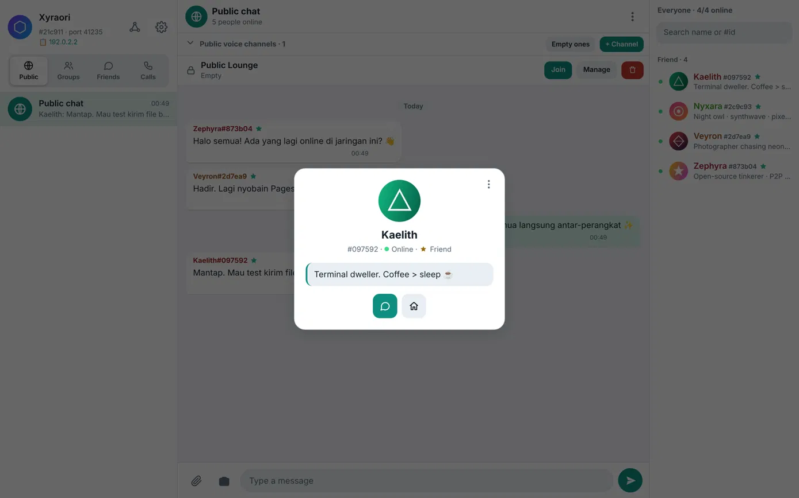
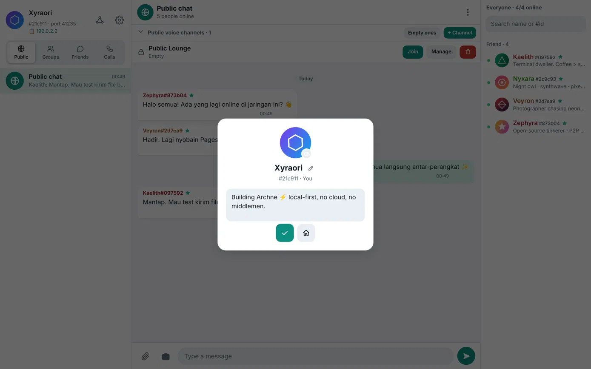

<div align="center">


# Archne

### Local social, without the cloud.

**No servers. No accounts. No middlemen.**
Chat, call, and share files directly between devices.
Your identity is just a key pair that lives on your own device.


**English** · [Bahasa Indonesia](README.id.md)

[Features](#-features) · [Install](#-install) · [Build](#-build) · [How it works](#-how-it-works) · [Development](#-development) · [Changelog](CHANGELOG.md)

</div>

 
 

---

## Why Archne?

Most chat apps depend on a company's servers. Your account lives there, your messages pass through there, and when the servers go down, so does the app.

Archne takes the opposite approach. Every device is an equal **peer**. Devices find each other on the same network (Wi-Fi or LAN) and exchange messages, calls, and files **directly**. There is no central server to trust, pay for, or lose. For friends on a different network, **cross-network mode** connects you with a private network code.

> **Status: beta.** The core features work and are used day to day, but some parts may still change. Found a bug? Please open an issue.

### 🆕 New in 0.32.0
- **Screen sharing in calls**, from Windows and from Android. Windows can add system sound (off by default); Android shares the sound of media apps.
- **Watch a shared screen on your phone** in full screen, with pinch-to-zoom.
- **Page backup** now includes comments and reactions.
- Fixes: Pages feed stopped loading on scroll, Android force close and endless loading when reopening the app, calls connect faster, and TURN is more reliable.

> **Updating from 0.30.0?** This is a big internal change. Old app data is **not** carried over. Android only installs the new APK over the old one if both are signed with the same key; otherwise uninstall first. Full details in the [changelog](CHANGELOG.md).

---

## ✨ Features

### 💬 Chat
- **Private chats, groups, and public rooms** on your local network.
- **Messages still arrive when the recipient is offline.** Other peers hold encrypted messages for you and deliver them as soon as the recipient is back, complete with delivery receipts.
- **Reply, react with emoji, delete, and pin** from the action menu on every message.
- **Group management**: owner and admins, invite or remove members, group avatars.
- **Friends, blocking, and built-in spam protection.**
- **Web links** open in a mini in-app browser.

### 📞 Calls
- **Voice and video calls**, one to one.
- **Group calls** with up to 8 participants.
- **Voice channels** for groups (lockable per member) and **public voice channels** protected by a 6-digit PIN.
- **Noise suppression** powered by RNNoise, running locally on your device.
- Call history and missed-call indicators.
- **Screen sharing** (Windows and Android) with optional system sound. One person shares at a time. Screen sharing shows everything on your screen, including notifications and other windows, so use it only with people you trust.

### 📎 Files and media
- **Send files** directly between devices: losslessly compressed and encrypted before they leave your device.
- **Direct Exchange** for transferring files with live progress tracking.
- **Camera photos and videos**, **voice notes**, an image viewer (zoom and pan), and a built-in media player.

### 📰 Pages
Pages are your own post space, like a social profile that lives on your device.
- Post text, images, videos, and attachments.
- **Threaded comments**, replies, and **reactions** on comments.
- Delete your own comments on other people's pages.
- New comments and reactions appear **instantly**, no refresh needed.
- **Backup and restore** your whole page, with comments and reactions, to a single `.archpg` file.
- Per-post privacy controls (friends only, disable downloads).

### 🌐 Cross-network
- Connect devices on different networks with a **network code** and an `archne://join?...` invite link.
- Encrypted signaling, direct WebRTC connections, and **TURN** support (Cloudflare, Metered, or manual) as a fallback.
- Relay-saving rules keep large files from burning through your TURN quota.

### 🎨 Look and feel
- **Light and dark** themes.
- Two languages: **English** and **Bahasa Indonesia**.
- Notifications on desktop and Android, including quick actions from Android notifications.
- Runs as a **desktop app**, an **Android APK**, or **right in your browser**.

---

## 📦 Install

### Requirements
- **Windows 10 / 11** for the desktop app. The `.bat` scripts install Node.js LTS through `winget` if it is missing.
- **Node.js 22.12 or newer** (LTS recommended) to run from source, use browser mode, or build.
- **Android 7.0 (API 24) or newer** to run the Android app.
- **To build the APK:** JDK 21 and the Android SDK (platform 36, CMake). `mobile.bat` installs both if missing, so Android Studio is optional.
- **Git** (optional, for cloning the repo).

### Easiest way (Windows)

```bash
git clone https://github.com/AdyXSetya/archne.git
cd archne
```

1. Run **`setup.bat`**. Node.js and dependencies are installed for you.
2. Run **`run.bat`** to launch Archne.
3. *(Optional)* Run **`firewall.bat`** if other devices cannot discover you on the network. It asks for administrator rights.

### From the terminal (any OS)

```bash
npm install
npm start          # launch the desktop app (Electron)
```

### Browser / headless mode (Linux, macOS, Termux)

No Electron needed. Great for Termux on a phone or a quick test.

```bash
npm install
npm run serve
# or with options:
node server.js --name "My Name" --port 8080 --data ./data-archne
```

Open the link printed in the terminal. It carries a session token that only works on that device.

| Option | What it does |
|---|---|
| `--name` | Display name (default: your system username) |
| `--port` | UI port (default: picked automatically) |
| `--data` | Data folder (default: `~/.archne`) |

### Ports

| Port | Protocol | Purpose |
|---|---|---|
| `41234` | UDP | Peer discovery on the local network |
| `41235` | TCP | Peer-to-peer communication (default) |

Allow both through your firewall if devices cannot see each other.

---

## 🔨 Build

Build output goes to the `dist/` folder.

### Windows (installer and portable)

```bash
build.bat            # or: npm run dist
```

This produces an **NSIS** installer and a **portable** `.exe`. The first build downloads Electron components, so it takes a while.

> Since Electron 42, `npm install` no longer downloads the Electron binary. `setup.bat` fetches it for you, or it is downloaded on the first `npm start`.

### Android (APK)

One command does everything. On first run it installs **JDK 21** and the **Android SDK** (platform 36, CMake) if they are missing:

```bash
mobile.bat                    # debug APK (all ABIs)
mobile.bat -Install           # ...then install it on a connected phone via adb
mobile.bat -Release           # signed release APK
mobile.bat -Release -Aab      # ...plus an AAB for Google Play
mobile.bat -Abis arm64-v8a    # one ABI only (smaller APK)
```

The Android app is a pure **Capacitor 8** shell with the **Node 24** runtime from `@capawesome/capacitor-nodejs`, so the very same Archne core runs right on the phone. There is no Cordova. The Node runtime (`libnode.so`) is about 120 MB per CPU architecture, so the universal APK carries all supported architectures (`arm64-v8a`, `armeabi-v7a`, `x86_64`). The Play AAB delivers only the matching one per device.

#### Release signing (back this up)

`-Release` signs the APK with `%USERPROFILE%\.archne\archne-release.jks` (alias `archne`, password in `release.pass` next to it). If the key does not exist yet, it is created on the first release build.

**Copy that folder to a private place** such as a USB drive. Never commit it to Git or share it in a chat (`.gitignore` already blocks `*.jks`). Android only lets a new APK update an installed app when both are signed with the same key. If the key is lost, everyone has to uninstall first and loses their local data.

### Windows and Android together

```bash
build-all.bat
```

### Script reference

| Script | What it does |
|---|---|
| `setup.bat` | Install Node.js and dependencies |
| `run.bat` | Run the desktop app |
| `debug.bat` | Run with diagnostic logging |
| `serve.bat` | Run browser mode |
| `firewall.bat` | Open Archne firewall rules (admin) |
| `build.bat` | Build the Windows installer |
| `mobile.bat` | Build the Android APK (`-Install`, `-Release`, `-Aab`, `-Abis`) |
| `build-all.bat` | Build Windows and Android |

Script logs are saved in the `logs/` folder.

---

## 🧭 How it works

**No server.** Every device runs its own Archne core. Peers are discovered through UDP broadcast on the local network, then talk to each other directly over TCP.

**Key-based identity.** No email, phone number, or password. Your ID is derived from a public key generated on your device, and your messages are signed with your private key.

**Encrypted.** Files are encrypted with AES-256-GCM before they are sent, and cross-network signaling is wrapped in encryption whose key is derived from your network code.

**Store and forward.** When the recipient is offline, an encrypted message is left with other peers under a quota and an expiry time, then re-sent when the recipient returns. The sender receives a receipt once it lands.

**Your data stays with you.** Messages, pages, and files are stored locally. There is no cloud.

> Archne is still in beta and has not been independently security audited. Please do not rely on it as your only channel for high-risk communication.

---

## 🩹 Troubleshooting

| Problem | Try this |
|---|---|
| Other devices can't see me | Run `firewall.bat` (Windows) or allow UDP `41234` and TCP `41235`. Make sure both devices are on the same Wi-Fi/LAN and that the router doesn't isolate clients (AP isolation). |
| Browser mode link doesn't open | Use the full link printed in the terminal, including the token. Open it on the same device that runs `npm run serve`. |
| Friend is on another network | Use cross-network mode: share your network code or the `archne://join?...` invite link. |
| Calls fail across networks | Configure a TURN provider (Cloudflare, Metered, or manual) in Settings. |
| Something looks wrong | Run `debug.bat` and check the `logs/` folder, then open an issue with the details. |
| Android app misbehaves | Connect the phone and run `adb logcat -s NodejsPlugin chromium Capacitor` to see the Node and WebView logs. |
| New APK will not install over the old one | The signing key differs. Uninstall the old app first (local data is lost). |

---

## 🛠 Development

```bash
npm install
npm start           # run the app
npm run serve       # browser mode
npm test            # run the whole test suite
```

> `npm test` runs hundreds of tests and can take a few minutes. To run only some of them: `node test/run-all.js name1 name2`.

### Project structure

```
archne/
├── main.js, preload.js     Main process and Electron bridge
├── server.js               Browser / headless mode
├── src/                    Core: protocol, storage, IPC, crypto
│   └── core/               Core modules (chat, calls, groups, pages, ...)
├── renderer/               User interface (HTML, CSS, JS)
│   ├── js/                 UI logic per feature
│   ├── css/                Styles
│   ├── i18n/               Language dictionaries (en, id)
│   └── vendor/             Third-party libraries (MQTT, RNNoise)
├── mobile/                 Android shell (Capacitor 8 + Node 24)
├── scripts/                Setup and build scripts
├── CHANGELOG.md            Release history
└── test/                   Test suite
```

> **Script load order.** The UI scripts in `renderer/js/` are plain global scripts loaded in the order of the `<script>` tags in `renderer/archne-index.html`. File names carry no order numbers, so when you add a new file, put its tag in the right place in that list. The tests read the same order from `archne-index.html`.

### Adding a language or new text

Add every new text key to both `renderer/i18n/archne-en.js` and `renderer/i18n/archne-id.js`. Keep the key names and tone consistent with the existing entries.

---

## 🤝 Contributing

Feedback, bug reports, and pull requests are very welcome. Since Archne is still in beta, please open an issue first for big changes so we can agree on direction.

## 📄 License

Released under the [MIT License](LICENSE). Use it, modify it, and share it however you like, just keep the copyright and license notice.

---

<div align="center">

Made by **xyraori**

</div>
